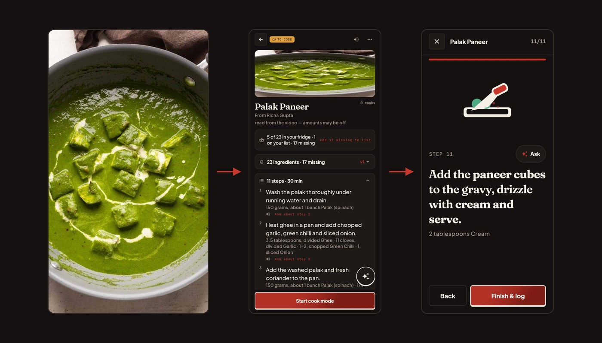
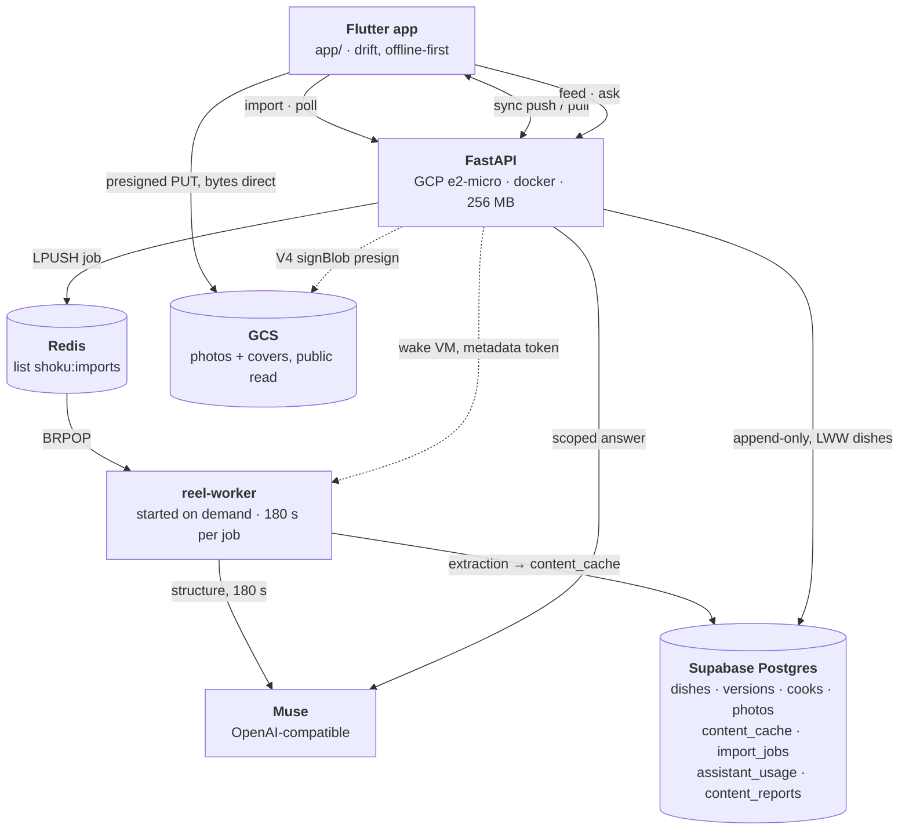
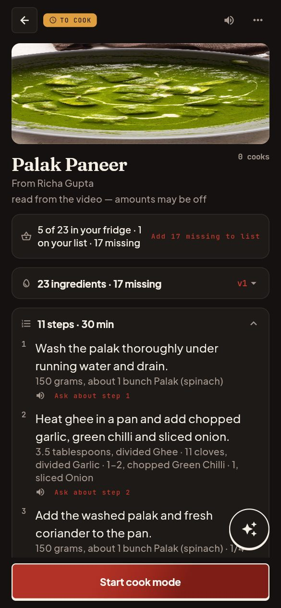
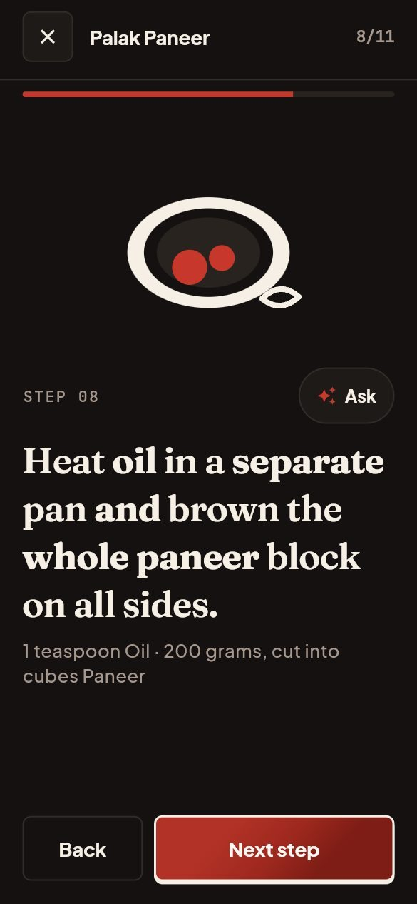
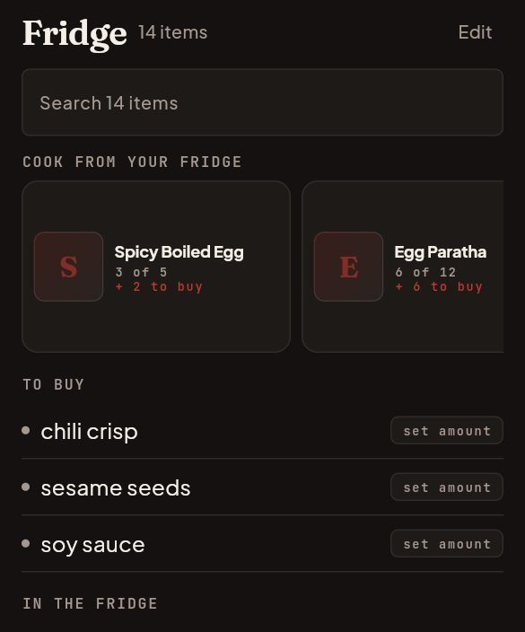
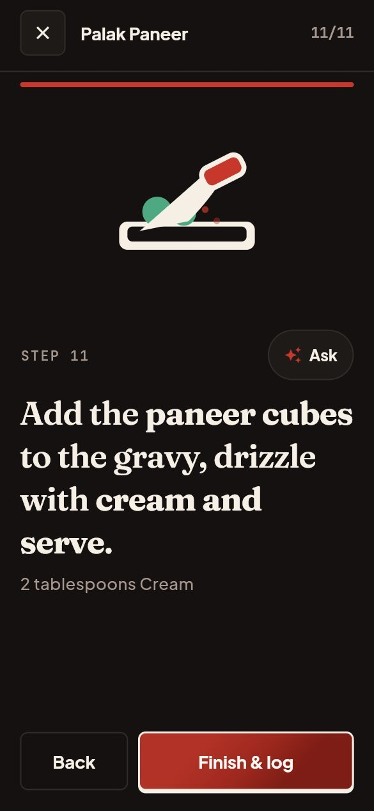
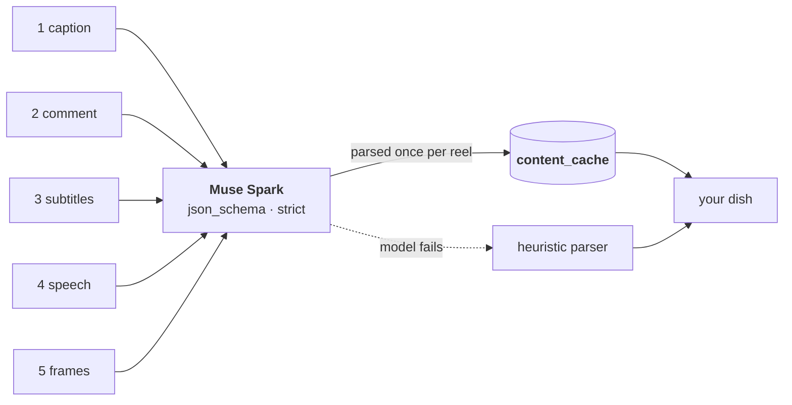

# Shoku

Send Shoku a cooking reel. It writes the recipe out — the method in order, every
step carrying its own ingredients — then answers questions at the stove, edits
when you ask, and counts what your fridge is missing.



> A recipe saved on Instagram is gone the moment you scroll past it. Shoku reads
> one into a page you cook from, and keeps every version after that.

The screenshots are real captures, not mockups: a Palak Paneer reel, the page it
became, and the same dish being cooked.

[](https://github.com/hawkaii/shoku/releases/latest)
[](#tests)
[](#ten-languages)
[](LICENSE)

An Android app in Flutter, and a FastAPI service behind it. Built for the **Meta
Global AI Developer Hackathon**, Indie Developer track, October 2026.

---

## Download

[**Latest release →**](https://github.com/hawkaii/shoku/releases/latest)

| Build | Size | For |
|---|---|---|
| `arm64-v8a` | 25.5 MB | most phones — start here |
| `armeabi-v7a` | 23.5 MB | older 32-bit phones |
| `x86_64` | 27.1 MB | emulators |
| `debug` | 173.7 MB | testing on a device |

Every build comes from GitHub Actions. Installing updates Shoku in place.

## How it fits together

One phone, one small server, and one VM that only wakes up to read a video.
Everything here is in this repository; every arrow is a call you can find.



Dotted edges are the API controlling something it does not own: a Compute
Engine instance it starts, and a bucket it signs for but never uploads to.
Voice in and out stays on the phone — speech recognition and text-to-speech
never leave the device.

---

## What it does

### A reel becomes a page

<p align="center">
  
</p>

Share a reel from Instagram or YouTube, or take one from the Wall. What comes
back is a page with the method in order.

- **Eleven steps, twenty-three ingredients** for the demo dish, and each step
  lists the amounts it uses: `1, sliced Onion`, `150 grams, about 1 bunch Palak`.
- **Amounts read off a video are estimates**, and the page says so in a line at
  the top instead of hiding it.
- **The creator keeps the credit.** Title, thumbnail and her name travel with the
  recipe, because the reel is where it came from.

### Ask at the stove, edit when you ask

<p align="center">
  
</p>

- **One thread per dish, and a kitchen thread with no dish at all.** The scope
  sits above the input, so you always know what it is looking at.
- **The question carries the step.** Ask at step 8 and the answer is about the
  pan in front of you.
- **An edit is a diff, not a rewrite.** It is computed against the version you are
  reading, comes back as the words it would change, and becomes v2 only when you
  press apply. v1 stays in the history.
- **Twenty asks a day**, shared between asking, editing, suggesting and
  capturing. Browsing the shelf and cooking do not count.

### It counts your fridge

<p align="center">
  
</p>

- **Five here, one on the list, seventeen to buy** — the three add to
  twenty-three, and the arithmetic is plain code, not a model.
- **Units convert inside a family**, grams to kilos, and never across one. A line
  that will not convert is left alone rather than guessed.
- **The model only chooses.** Candidates are computed from the Wall against your
  shelf; the model picks three and names what each one is missing.
- **A receipt photo is read once.** It goes to a vision model, comes back as rows
  you confirm, and is not kept.

### The cook is part of the record

<p align="center">
  
</p>

- **Cook mode** steps through the method one screen at a time, with a timer, the
  ingredients for that step, and a speaker that reads it aloud — off by default,
  remembered on the phone.
- **Every cook and every edit forks a version.** Two versions can be compared, and
  the older one is never overwritten. That is the whole reason the journal exists.
- **A cook can carry a photo** of what actually came out of the pan, and the dish
  keeps it.
- **The Wall** is a public feed of imported reels. It shows the extraction only:
  never anyone's versions, edits, cook data or identity.

---

## Ten languages

English · हिन्दी · मराठी · বাংলা · தமிழ் · తెలుగు · Español · Français · Português ·
Bahasa Indonesia

The language is picked on the first screen and changed later in **You**; System
default follows the phone. Every interface string lives in an ARB file, and all
ten locales are kept at parity.

Content is not translated. A recipe stays in the language it was written in, and
the assistant answers in the language you chose while the operations it runs stay
in English — so an edit reads the same whichever language asked for it.

---

## How it reads a video

A reel is hostile input. Sometimes the caption holds the whole recipe. Sometimes
the quantities are in a pinned comment. Sometimes the caption is `#food #recipe`
and the method is burned onto the video while someone cooks silently.

The pipeline tries those in order and falls through:




- **Meta Model API, Muse Spark** (`muse-spark-1.3`) does the structuring with
  `response_format: json_schema` and `strict`, so the decoder can only emit a
  recipe. A caption trying to give the model orders has nowhere to land.
- **Reasoning effort is pinned to `minimal`** with a generous token budget. Muse
  reasons before answering and bills those tokens as output; a budget sized for
  the recipe alone returns `content: null`.
- **Vision over sampled frames** handles silent reels: ffmpeg pulls sixteen
  stills, the model reads the on-screen text and the visible actions, and the
  result is tagged `from video` because nobody stated those amounts.
- **A heuristic fallback** means a model outage degrades the parse instead of
  losing the recipe.

Everything is cached globally by reel, so a viral recipe is parsed once, ever.

---

## Architecture

The map is above; these are the rules that are not visible in it.

- **API** — FastAPI in Docker on `instance-20260524-054843`, an e2-micro, capped
  at 256 MB alongside a 64 MB Redis. Supabase tokens are verified against the
  project's JWKS; nothing trusts a client's claim about who it is.
- **Queue** — one Redis list, `shoku:imports`. The API `LPUSH`es a job id and the
  worker `BRPOP`s it. A job that no worker picks up is failed on a timer rather
  than left to look pending forever.
- **Worker** — `reel-worker`, a separate VM the API starts over the Compute REST
  API using its own metadata token, so no key ships with the container. It reads
  with yt-dlp, transcribes with faster-whisper, structures with Muse, and gives
  each job 180 seconds. After 300 seconds with an empty queue it stops its own
  instance, and the Hugging Face models live on a named volume so a cold start
  does not re-download them.
- **Sync** — client-generated UUIDs, append-only versions and cooks unioned by
  id, last-write-wins on dish metadata, tombstones for deletes. A pull on an
  empty device restores the whole journal.
- **Assistant** — stateless on the server. The client sends the thread, and an
  edit is preconditioned on the version it was computed against.
- **Storage** — `shoku-media-oceanic-archery-453217-v6` holds user photos and
  reel covers, public read. User bytes go straight from the phone on a presigned
  PUT; the signed URL is minted by the API through `signBlob`, so the container
  holds no bucket key. Reel covers are the one upload the server does itself,
  because the source link is already expiring when it is fetched.
- **Cost** — the API runs on a free-tier VM, the worker only while importing.

The layer rules, the module map and the test conventions are in
[docs/ARCHITECTURE.md](docs/ARCHITECTURE.md). What the app is currently fixing,
and why, is in [docs/STABILITY.md](docs/STABILITY.md).

---

## Running it

```bash
# api
cd api && python -m venv .venv && .venv/bin/pip install -e ".[dev,prod]"
cp .env.example .env          # Supabase URL/keys, Muse key, storage bucket
.venv/bin/alembic upgrade head
.venv/bin/uvicorn shoku_api.asgi:app --reload

# app
cd app && flutter pub get && flutter run
```

`api/DEPLOY.md` is the two-machine runbook. The dev API runs at
`http://35.188.27.251:8000`; `/health` is the liveness check.

```bash
# the landing page — plain HTML, no build step
cd landing && python3 -m http.server 8100
```

`landing/` is [shoku.gradientdescent.wiki](https://shoku.gradientdescent.wiki),
deployed by Vercel from this directory. Its own README explains the design and
where every number on it came from.

## Tests

Both suites run without network, Postgres or Redis.

```bash
cd app && flutter test     # 314 tests
cd api && pytest -q        # 282 tests
```

The app suite covers the journal, versions, the assistant's failure
classification, the fridge arithmetic and the ARB parity of all ten locales. The
API suite covers the import pipeline against fake models, the assistant's closed
operation set, sync and the pantry endpoints.

---

## Design

The app and the landing page share one set of tokens, taken from
`app/lib/core/theme/shoku_theme.dart`. Shoku is a kitchen ticket at night: near
black, one crimson accent, hairlines, and mono for anything you measure. The only
light surfaces are the things you would print.

| Token | Value |
|---|---|
| Ground | `#141110`, surface `#1E1A18`, hairline `#332B27` |
| Ink | `#F5EFE6`, muted `#A6988E` |
| Accent | crimson `#C8372B`, green `#4EA882`, amber `#E09F3E` |
| Type | Fraunces for display, Karla for reading, JetBrains Mono for numbers |

The rules that keep it from drifting are written down in
[`shoku-landing/DESIGN.md`](https://github.com/hawkaii/shoku-landing/blob/main/DESIGN.md), and the
[landing page](https://github.com/hawkaii/shoku-landing) is built from the same tokens.

---

## Known limitations

- Recipes read from a silent reel carry **guessed amounts**, labelled `from
  video`. The app never invents a number and presents it as measured.
- Nutrition is deliberately **not estimated** (`kcal`/`protein` are zero). The
  screen says coming soon.
- The Wall has **no user-facing report or takedown path** yet; an operator can
  remove a reel.
- **Android only.** There is no iOS build.
- Release APKs are currently **signed with a debug key**. Play submission is
  pending release signing, an HTTPS API and the data-safety declarations; the
  checklist is in [`PLAY_STORE_READINESS.md`](PLAY_STORE_READINESS.md).
- The Instagram importer runs **without authenticated cookies**, so it reads what
  a logged-out request can see.

## Licence

MIT — see [`LICENSE`](LICENSE).
